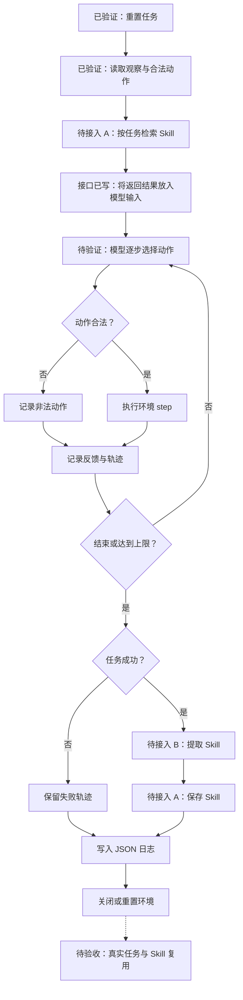

# 同学 C：Agent Loop 与 ALFWorld 接入

## 当前流程图

图中「已验证」仅指模拟测试或真实 ALFWorld 环境单步检查；「接口已写」表示调用位置存在，但尚未接入同学 A/B 的正式模块。Skill 检索、提取、保存及真实任务中的复用均未验收。



## 实现与验证状态

| 环节 | 状态 | 当前行为 |
| --- | --- | --- |
| ALFWorld 文本环境 | 单步已验证 | 官方 `AlfredTWEnv` 的 `valid_seen` 数据可加载，`reset()`、合法动作和一次 `step()` 已通过。 |
| Agent Loop 与成功判定 | 模拟已验证 | LangGraph 循环、动作合法性、`done`/`won` 判定及失败隔离通过单元测试；真实模型任务尚未运行。 |
| 轨迹和日志 | 模拟已验证 | 每轮记录观察、合法动作、动作与反馈；日志记录检索结果和 hook 状态，不声称模型实际采用了 Skill。 |
| Skill 检索 | 待接入 A | `--search-hook` 可加载 `search_skill(task)`。未配置时返回空列表，当前没有正式检索算法或 Skill 库。 |
| Skill 注入 | 接口已写，待真实验证 | 将检索返回的列表整体序列化为 JSON，放入每次 DeepSeek 动作请求的 `skills` 字段；没有筛选或重排。模拟模式忽略该字段。 |
| Skill 提取与保存 | 待接入 B/A | 成功任务后才会调用对应 hook；正式模块尚未交付，未完成真实提取与保存。 |

`retrieved_skill_ids` 仅表示检索返回的 ID，不表示模型实际使用了这些 Skill。

## 待做与验收条件

1. **接入同学 A/B 的正式实现。** A/B 模块尚未交付。预期接口为 `search_skill(task: str) -> list[dict]`、`extract_skill(task: str, trace: list[dict]) -> dict | None`、`save_skill(candidate: dict) -> Any`。如真实签名不同，只在 `skill_hooks.py` 加薄适配。
2. **真实模型运行。** 由用户在 WSL 中配置 `DEEPSEEK_API_KEY` 后，运行真实 ALFWorld 任务并核查逐步动作与 JSON 日志。不要将 Key 写入项目文件。
3. **Skill 复用验收。** A/B 模块和 Key 齐备后，在同一数据划分中跑至少两项相似任务，检查第一项成功轨迹、B 提取结果、A 保存结果、第二项检索命中及实际动作。模拟测试不能替代这项验收。

## WSL/Linux 环境

从仓库根目录进入 `langgraph_skill_demo`。Linux/WSL 使用 Conda 环境 `langgraph-alfworld`（Python 3.11）；Python 3.9 与 `langgraph>=1.0` 不兼容。不要提交本地虚拟环境。

```bash
cd langgraph_skill_demo
conda create -n langgraph-alfworld python=3.11
conda activate langgraph-alfworld
python -m pip install -r requirements.txt alfworld
alfworld-download
```

下载数据默认位于 `~/.cache/alfworld`，不提交到仓库。各人按自己的网络环境配置代理；运行时可用 `ALFWORLD_DATA` 或 `--alfworld-data` 指定数据目录。

检查项目本身：

```bash
cd langgraph_skill_demo
conda activate langgraph-alfworld
python -m unittest test_agent_loop.py
python main.py --graph
python main.py --mode mock --episodes 2
```

真实 ALFWorld 文本环境验证使用 `valid_seen`。环境初始化、`reset()`、合法动作和一次 `step()` 可以在没有模型 Key 时单独检查；完整 Agent Loop 需要 Key：

```bash
export DEEPSEEK_API_KEY='你的 Key'
python main.py --mode alfworld --split valid_seen --episodes 2 --max-steps 30
```

若 A/B 模块已加入 Python 导入路径，再追加 `--search-hook a_module:search_skill --extract-hook b_module:extract_skill --save-hook a_module:save_skill`。只在真实任务成功时提取并保存 Skill。日志写入 `logs/`，每个任务一份 JSON。`--mode mock` 不调用 DeepSeek，也禁止连接正式 `save_skill`。独立的旧演示文件已清理。

## 接口依据

- [ALFWorld 官方 README 的文本环境调用示例](https://github.com/alfworld/alfworld/blob/master/README.md)：`reset()`、`step([action])` 和 `admissible_commands`。
- [ALFWorld 官方 `AlfredTWEnv` 实现](https://github.com/alfworld/alfworld/blob/master/alfworld/agents/environment/alfred_tw_env.py)：评估划分不添加专家计划包装器。
- [DeepSeek JSON Output 文档](https://api-docs.deepseek.com/guides/json_mode/)：动作选择使用 JSON 输出并在本地校验。
